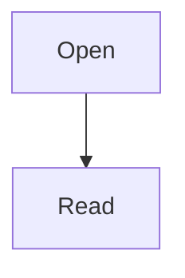

# Inline sticker development

Click a supported paragraph to edit in the note. Original Save is explicit.

Duplicate **bold words** and *italic words*. 한국어 😀 stays here.

Duplicate **bold words** and *italic words*. 한국어 😀 stays here.

[Unsupported link](https://example.invalid) and `inline code` stay readable.

> Quoted text is not editable in this first integration.

- [ ] Checklist clicks are a later milestone.

```rust
fn main() { println!("keep exact source"); }
```



| Left | Right |
| :--- | ---: |
| 한국어 | 123 |


Final paragraph remains after the edited text.
