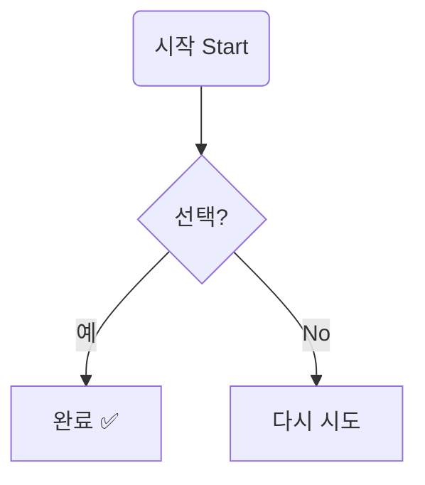
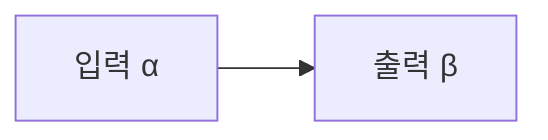
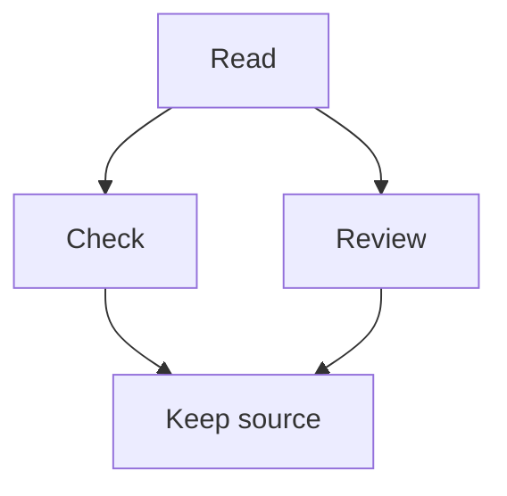
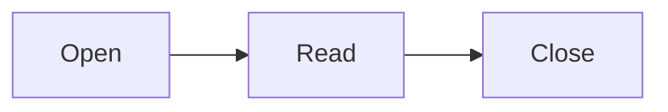
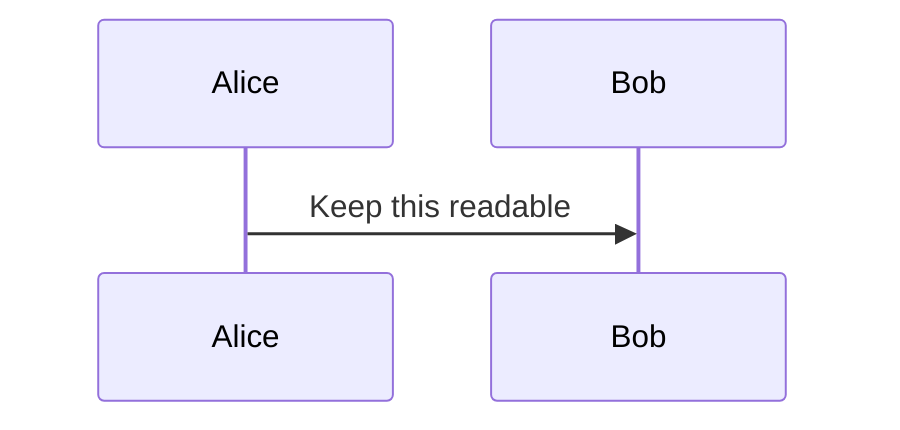
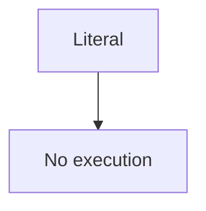
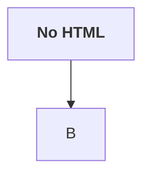

# Native Mermaid

Branching labels stay native, including 한국어 and Unicode.



## Left to right



## Merge and chain





## Unsupported stays code







```mermaid
graph TD
    A[unclosed --> B
```

## Ordinary Markdown survives

```rust
fn main() {
    println!("graph TD; A-->B is ordinary code");
}
```

~~~text
  whitespace and blank lines

  stay readable
~~~

- [x] Source is read-only in sticker mode.
- **Bold**, *italic*, `inline code`, and a [safe link](https://example.com/markdown).

> A quote after native diagrams.

| Left | Center | Right |
| :--- | :---: | ---: |
| keep | 한국어 | 123.45 |


---

Final paragraph: Mermaid never changes the Markdown source bytes.
